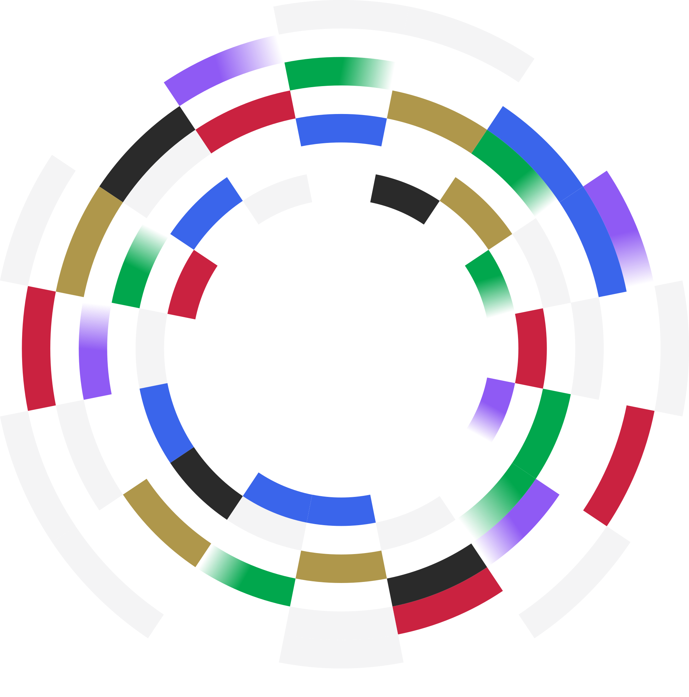

{/* ── Hero ── */}

  

    <h1
      style={{
        fontSize: "3.25rem",
        fontWeight: "400",
        marginBottom: "0.75rem",
        lineHeight: 1.1,
      }}
    >
      Welcome to 0x Docs
    </h1>
    

      The trading API for every chain. Liquidity from 150+ sources across EVM,
      Solana, Bitcoin, Tron, and HyperCore — one integration, everywhere.
    

    

      <a href="https://dashboard.0x.org/" className="hero-btn-primary">
        Create an API key
      </a>
      <a
        href="/docs/introduction/quickstart/swap-tokens-with-0x-swap-api"
        className="hero-btn-secondary"
      >
        Quickstart guides
      </a>
      <a
        href="https://github.com/0xProject/0x-examples"
        className="hero-btn-secondary"
      >
        Explore demo apps
      </a>
    

  

  

    
    
  

{/* ── Build with AI ── */}

<h2 style={{ textAlign: "center" }}>Build with AI</h2>

<CardGroup cols={3}>

<Card title="Overview" href="/docs/introduction/develop-with-ai/using-ai-with-0x">
  Use 0x Docs with LLMs and AI tools.
</Card>

<Card title="Agent Skills" href="/docs/introduction/develop-with-ai/agent-skills">
  Give your coding agent full knowledge of the 0x APIs.
</Card>

<Card title="MCP Server" href="/docs/introduction/develop-with-ai/mcp-setup">
  Connect AI tools to the 0x docs.
</Card>

<Card title="CLI" href="/docs/introduction/develop-with-ai/0x-cli">
  Trade across EVM and Solana from your terminal.
</Card>

<Card title="x402 / MPP" href="/docs/introduction/develop-with-ai/autonomous-agent-payments">
  Pay per request in USDC, no API key needed.
</Card>

<Card title="llms.txt" href="https://docs.0x.org/llms.txt">
  Point your AI tools at a full index of 0x Docs.
</Card>

</CardGroup>

{/* ── Explore 0x Products ── */}

<h2 style={{ textAlign: "center" }}>Explore 0x Products</h2>

<CardGroup cols={3}>

<Card title="EVM Swap API" href="/evm/0x-swap-api/introduction">
  Embed token swaps on any EVM chain. Aggregated liquidity from 150+ sources.
</Card>

<Card
  title="Solana Swap API"
  href="/solana/solana-swap-api/introduction"
>
  Native Solana support. Fast, low-cost token swaps with deep SPL token
  liquidity.
</Card>

<Card
  title="Cross-Chain API"
  href="/cross-chain/cross-chain-api/introduction"
>
  Swap any token across any chain in one transaction.
</Card>

<Card title="Gasless API" href="/evm/gasless-api/introduction">
  Enable seamless, gasless DeFi transactions.
</Card>

<Card
  title="Trade Analytics API"
  href="/evm/trade-analytics-api/introduction"
>
  Track and analyze trades routed through 0x.
</Card>

<Card title="RWAs" href="/rwa/introduction">
  Trade tokenized equities, commodities, and treasuries through the same 0x APIs.
</Card>

</CardGroup>

{/* ── Quick Links ── */}

<h2 style={{ textAlign: "center" }}>Quick Links</h2>

<CardGroup cols={3}>

<Card
  title="Build with Swap API"
  href="/evm/0x-swap-api/guides/swap-tokens-with-0x-swap-api"
>
  Get started with Swap API
</Card>

<Card
  title="Code Examples"
  href="https://github.com/0xProject/0x-examples"
>
  Ready-to-use 0x code examples
</Card>

<Card
  title="Monetize your app"
  href="/evm/0x-swap-api/guides/monetize-your-app-using-swap"
>
  Unlock new revenue streams with 0x
</Card>

<Card
  title="Supported Chains"
  href="/docs/introduction/supported-chains"
>
  Supported networks and liquidity provider information
</Card>

<Card title="Contracts" href="/docs/core-concepts/contracts">
  0x contract addresses on every supported chain
</Card>

<Card title="API References" href="/api-reference/api-overview">
  Endpoints, parameters, and responses for every 0x API
</Card>

</CardGroup>

{/* ── Release Highlights ── */}

<h2 style={{ textAlign: "center" }}>Release Highlights</h2>

| Date           | Update                                                                                                              | API                                    |
| -------------- | ------------------------------------------------------------------------------------------------------------------- | -------------------------------------- |
| October 2026   | [Bitcoin is now supported for cross-chain swaps](https://docs.0x.org/changelog#2026-10-31-new-chains)               | Cross-Chain API                        |
| October 2026   | [Fees and trade surplus can now be set in parts-per-million](https://docs.0x.org/changelog#2026-10-31-new-features) | Swap API, Gasless API, Cross-Chain API |
| September 2026 | [Arc (`5042`) is now supported across all three APIs](https://docs.0x.org/changelog#2026-09-30-new-chains)          | Swap API, Gasless API, Cross-Chain API |

<a
  href="/changelog"
  style={{ display: "block", textAlign: "center", marginTop: "0.5rem" }}
>
  See all updates →
</a>

{/* ── Help ── */}

<h2 style={{ textAlign: "center" }}>Need Help?</h2>

<CardGroup cols={4}>

<Card title="FAQ" href="/docs/introduction/faq" />

<Card
  title="API Issues & Error Codes"
  href="/docs/introduction/api-issues"
/>

<Card
  title="Support"
  href="/docs/introduction/need-help#-contact-developer-support-fastest-direct-help"
/>

<Card title="System Status" href="https://0x.statuspal.io" />

</CardGroup>

