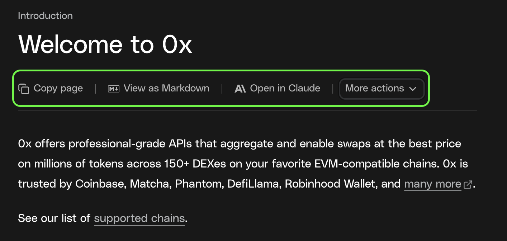

0x Docs includes built-in AI integrations, 0x skills, and an official MCP server so you can work with up-to-date documentation directly inside your AI tools and editor.

See the options available from the **page actions menu** on any documentation page.



## Get started

<div className="ai-start-cards">

<CardGroup cols={2}>

<Card
  title="Connect to the 0x MCP Server"
  href="/docs/introduction/develop-with-ai/mcp-setup"
>
  Give AI tools live access to 0x Docs.
</Card>

<Card
  title="Install 0x Agent Skills"
  href="/docs/introduction/develop-with-ai/agent-skills"
>
  Teach your coding agent the 0x APIs in one command.
</Card>

<Card
  title="Trade from the terminal with the 0x CLI"
  href="/docs/introduction/develop-with-ai/0x-cli"
>
  Swap, bridge, and trade gasless from your terminal.
</Card>

<Card
  title="Use an LLM"
  href="/docs/introduction/develop-with-ai/using-ai-with-0x#use-llmstxt"
>
  Bring 0x Docs into any LLM with llms.txt or copy options.
</Card>

<Card
  title="AI Projects with 0x"
  href="/docs/introduction/develop-with-ai/ai-tools"
>
  See AI tools built on 0x.
</Card>

<Card
  title="Autonomous Agent Payments"
  href="/docs/introduction/develop-with-ai/autonomous-agent-payments"
>
  Pay per request in USDC with x402 or MPP. No API key needed.
</Card>

</CardGroup>

</div>

## Available Options

Below is a list of all available options, what they do, and when to use them.

### Install Agent Skills

Give your AI coding agent built-in knowledge of the 0x API — no manual prompting or copy-pasting docs required.

```bash
npx skills add 0xProject/0x-ai
```

Once installed, your agent understands the full 0x Swap API surface: swap flows, gasless transactions, authentication, error handling, and chain-specific details. Works with Claude Code, Cursor, GitHub Copilot, and other agents that support the [Agent Skills specification](https://agentskills.io).

→ See the full setup guide: **[0x Agent Skills](/docs/introduction/develop-with-ai/agent-skills)**

Agent Skills are the recommended starting point if you're actively building a swap integration in your editor.

---

### Connect via MCP

For the best AI development experience, connect your editor or AI assistant to the **0x MCP Server**.

MCP gives AI tools live, searchable access to 0x documentation — no copy-pasting required.

→ Follow the full setup guide: **[Connect to the 0x MCP Server](/docs/introduction/develop-with-ai/mcp-setup)**

If you're building in an IDE or working on a multi-step integration, MCP is the recommended approach.

---

### Trade from the terminal with the 0x CLI

The **0x CLI** is a single binary, `0x`, that wraps the 0x Swap, Gasless, Solana, and Cross-Chain APIs. It's built to be driven by both humans and AI agents: every command is non-interactive-safe and emits a machine-readable JSON envelope with stable exit codes.

```bash
0x swap --chain base --sell USDC --buy WETH --amount 1000000 --yes -o json-envelope
```

→ See the full guide: **[0x CLI](/docs/introduction/develop-with-ai/0x-cli)**

Use the CLI when you want an agent to *execute* trades as a tool, rather than write API client code itself.

---

### Use llms.txt

0x Docs publishes an [llms.txt](https://docs.0x.org/llms.txt) file: a plain-text index of every docs page, with a link and a one-line summary for each. AI tools and agents can read it to find the right page without crawling the site.

```
https://docs.0x.org/llms.txt
```

- **Section indexes:** append `/llms.txt` to any section URL to get an index of just that section, such as `https://docs.0x.org/evm/0x-swap-api/llms.txt`.
- **Markdown for any page:** append `.md` to a page URL to get clean Markdown, such as `https://docs.0x.org/docs/introduction/faq.md`.

#### When to use

Give an agent or custom tool a starting point for 0x Docs when it can't connect to the [MCP server](/docs/introduction/develop-with-ai/mcp-setup), or when you want to load docs into your own RAG pipeline.

#### How to use

Paste the URL into your AI tool, or have your agent fetch it and follow the links to the pages it needs.

---

### Copy Page

Copies the page in a format optimized for AI tools.

- Preserves structure and code blocks
- Removes UI and navigation noise

#### When to use

Paste into any LLM to ask questions or generate code using the current page as context.

#### How to use

Select **Copy page**, then paste into your AI tool.

---

### View as Markdown

Shows the raw Markdown source of the page.

#### When to use

Inspect, edit, or selectively share content before sending it to an AI tool.

#### How to use

Select **View as Markdown**, then copy what you need.

---

### Ask AI

Ask questions about the current page directly in the docs.

#### When to use

Get quick explanations without leaving the documentation site.

#### How to use

Select **Ask AI** and enter your question.

---

### Open in ChatGPT

Opens the page in ChatGPT with context included.

#### When to use

Quick Q&A or code generation based on a single page.

#### How to use

Select **Open in ChatGPT** to continue in ChatGPT.

---

### Open in Claude

Opens the page in Claude with full context.

#### When to use

Deeper analysis or longer-form reasoning about the page.

#### How to use

Select **Open in Claude** to continue in Claude.
