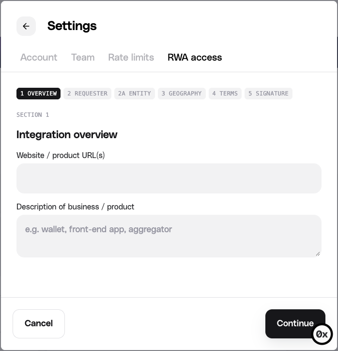

To trade tokenized real-world assets (RWAs) through 0x, your team accepts the RWA trading agreement once in the [0x Dashboard](https://dashboard.0x.org/). Access applies to every app and API key on the team and takes effect immediately. You don't apply, wait for review, rotate keys, or change code.

New to RWAs on 0x? Start with [Introduction to RWAs](/rwa/rwa/introduction).

## Before you begin

- You need a 0x account and a team. See [Create a 0x API Key](/docs/introduction/quickstart/getting-started).
- Have your legal or compliance team review the agreement. You accept it on behalf of your organization.

## Opt in

New teams see an RWA step during signup. You can accept it there, or skip it and opt in later from the dashboard.

{/* TODO(pre-launch): screenshot of the signup RWA step. Save to ../../assets/img/introduction/0x-dashboard-rwa-signup-step.png */}

To opt in from the dashboard:

<Steps>
  <Step>
    Sign in to the [0x Dashboard](https://dashboard.0x.org/), open **Settings**,
    and select the **RWA access** tab.
    {/* TODO(pre-launch): confirm how users open Settings from the dashboard home (e.g. avatar menu or sidebar). */}
  </Step>
  <Step>
    Select **Request access**.

    {/* TODO(pre-launch): add the RWA access tab screenshot at ../../../assets/img/rwa/dashboard-rwa-access-tab.png, then uncomment:
    
    */}
  </Step>
  <Step>
    Complete each section of the request form, then submit:

    - **Overview**: your website or product URLs and a short description of your business, such as a wallet, front-end app, or aggregator.
    - **Requester**: details about you, the person submitting the request.
    - **Entity**: the legal entity you are requesting access for.
    - **Geography**: where you offer your product.
    - **Terms**: review and accept the Regulated Digital Assets Terms.
    - **Signature**: sign on behalf of your organization.

    {/* TODO(pre-launch): confirm the fields in Requester, Entity, and Geography and list anything integrators should prepare in advance. */}

    
  </Step>
</Steps>

## Confirm RWA access is live

The **RWA access** tab shows your team's status. Before you request access, it shows **Not enabled**.

{/* TODO(pre-launch): document the status labels after submission (e.g. pending, enabled) and include the exact error code returned before access is enabled (likely BUY_TOKEN_NOT_AUTHORIZED_FOR_TRADE / SELL_TOKEN_NOT_AUTHORIZED_FOR_TRADE) so users can recognize it. */}

## Have a question?

Message us through the Pylon Messenger in the bottom-right corner of the [0x Dashboard](https://dashboard.0x.org/), or contact [0x Support](/docs/introduction/need-help) about the agreement.

## Related

<CardGroup>

<Card title="RWA Quickstart" href="/rwa/guides/quickstart" icon="rocket">
  Price and execute your first RWA trade with Swap API.
</Card>

<Card title="Introduction to RWAs" href="/rwa/introduction" icon="circle-info">
  What counts as an RWA on 0x, and how execution differs.
</Card>

<Card
  title="Create a 0x API Key"
  href="/docs/introduction/quickstart/getting-started"
  icon="key"
>
  Set up an account, create a team, and get a live API key.
</Card>

</CardGroup>
